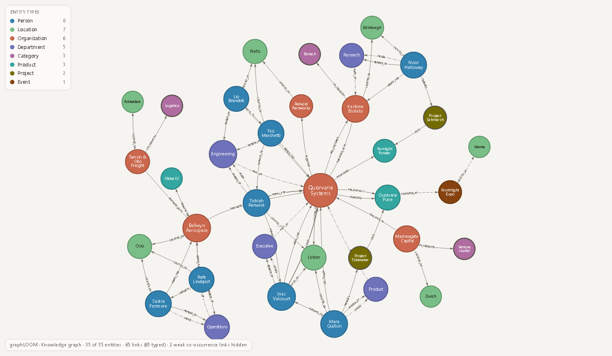

<div align="center">

# 🕸️ GraphLoom

**Drop in your files. Get an ontology and a knowledge graph — in a single HTML page.**

[](#-quick-start)
[](#-quick-start)
[](#-privacy)
[](#-export)
[](LICENSE)

[Features](#-features) •
[Quick start](#-quick-start) •
[Usage](#-usage) •
[Supported files](#-supported-files) •
[Export](#-export) •
[FAQ](#-faq)

<!-- Replace with a screenshot or GIF of the app -->


</div>

---

## ✨ About

**graphLOOM** weaves documents, spreadsheets and images into a typed **knowledge graph**, and shows you the
**ontology** behind it — the classes and relationship types — before morphing into the actual entities.

It is one self-contained HTML file. No install, no server, no account: open it, drop a folder, explore.
Everything is processed locally in your browser.

## 🚀 Features

| | |
|---|---|
| 🧭 **Ontology ⇄ Knowledge graph** | See classes and relationship types first, then morph into the entities behind them |
| 📂 **Reads almost anything** | PDF (incl. scanned), DOCX, XLSX, CSV, JSON, Markdown, HTML, XML, code, logs, images |
| 🔎 **Understands structure** | Spreadsheet IDs and foreign keys, org charts (even connector lines in images), research papers (authors, affiliations, references), key–value records, Mermaid diagrams |
| 🧾 **Provenance on every link** | Each relationship is *explicit*, *inferred* or *co-occurrence*, with its source sentence |
| 🪪 **Clean identities** | Plurals, aliases (`UK` = `United Kingdom`), acronyms and typos merged or suggested for one-click review |
| 🗺️ **Readable at any size** | Communities, collapsible clusters, hub-first labels, force or hierarchy layout |
| 🤖 **Optional AI** | Offline in-browser entity model, or NVIDIA NIM / any OpenAI-compatible LLM and vision endpoint |
| 💾 **Remembers your session** | Reopen the page and your last graph is back exactly as you left it |
| 📤 **Exports** | Neo4j Cypher & direct push, Excel (re-importable for review), JSON, CSV triples, Turtle, PNG |

## ⚡ Quick start

Right click on the file and download ontology-graph-explorer.html

OR

```bash
git clone https://github.com/pavansreddy/graphLOOM.git
cd graphloom
```

Then open `ontology-graph-explorer.html` in Chrome, Edge or Firefox — that's it.

1. Click **Upload files**, **Choose folder**, or drag files onto the page (or try **Try sample**).
2. Browse the **Ontology**, then switch to the **Knowledge Graph**.
3. Click any node or link to see its properties, provenance and source sentences.

> [!NOTE]
> An internet connection is needed on first use to load the graph and file-reading libraries from public CDNs.
> Your files are never uploaded.

## 📖 Usage

| I want to… | Do this |
|---|---|
| Switch views | **Ontology / Knowledge Graph** toggle, or <kbd>O</kbd> / <kbd>K</kbd> |
| Zoom and move | Scroll or **＋ / −**; drag the background; **Fit** or <kbd>0</kbd> |
| Change layout | **Layout: force / hierarchy**; **Re-layout** reruns the force layout |
| Explore a class | Double-click it in the ontology |
| Hide a class | Click it in the legend |
| Reduce clutter | <kbd>[</kbd> → *Readability*: min mentions, max nodes, links shown |
| Colour by community | <kbd>[</kbd> → *Colour by: Community*; *Clusters* collapses them (double-click to open) |
| Fix duplicates | <kbd>[</kbd> → *Quality* → *Possible duplicates* → **Merge** / **Keep apart** |
| Use the AI entity model | <kbd>[</kbd> → tick *AI entity model* (one-time ~66 MB) → **Re-run extraction** |
| Use NVIDIA NIM / an LLM | <kbd>[</kbd> → *Extraction engine* → *NVIDIA NIM (LLM)* → endpoint, model, API key |
| Start over | <kbd>[</kbd> → *Files* → **Clear** |
| Verify the engine | <kbd>[</kbd> → *Quality* → **Run self-test** |

<details>
<summary><b>⌨️ Keyboard shortcuts</b></summary>

| Key | Action |
|---|---|
| <kbd>[</kbd> / <kbd>]</kbd> | Settings / details panel |
| <kbd>O</kbd> / <kbd>K</kbd> | Ontology / Knowledge graph |
| <kbd>/</kbd> | Search |
| <kbd>+</kbd> <kbd>−</kbd> <kbd>0</kbd> | Zoom in / out / fit |
| <kbd>?</kbd> | Help |
| <kbd>Esc</kbd> | Clear selection |

</details>

## 📄 Supported files

| Type | Formats |
|---|---|
| Documents | PDF (text & scanned), DOCX, TXT, Markdown, HTML, XML, RTF-like text, code & logs |
| Data | XLSX, CSV, TSV, JSON, JSONL |
| Images | JPG, PNG, WebP, GIF, BMP, TIFF — via offline OCR, or NIM vision |

## 📤 Export

| Format | Use it for |
|---|---|
| **Cypher** / **Push to Neo4j** | Load into Neo4j; `CALL db.schema.visualization()` shows the same ontology |
| **Excel** | Review in a spreadsheet (accept / reject / reclassify), then drop it back in |
| **JSON** | The full graph with provenance and quality diagnostics |
| **CSV** | Subject–predicate–object triples with evidence |
| **Turtle** | The ontology as RDF |
| **PNG** | An image of the current view |

## 🔒 Privacy

Parsing, OCR, extraction and the optional AI entity model all run **locally in your browser**. Data leaves your
machine only if you choose the NIM / LLM engine (sent to the endpoint you configure) or push to your own Neo4j.
The saved session lives in your browser's storage only.

## 🛠️ Built with

[vis-network](https://visjs.github.io/vis-network/) · [PDF.js](https://mozilla.github.io/pdf.js/) ·
[Tesseract.js](https://tesseract.projectnaptha.com/) · [SheetJS](https://sheetjs.com/) ·
[mammoth.js](https://github.com/mwilliamson/mammoth.js) · [Transformers.js](https://huggingface.co/docs/transformers.js)

## ❓ FAQ

<details>
<summary><b>Do I need Python, Node or a database?</b></summary>

No. Open the HTML file in a browser. Neo4j is optional, only if you want to export there.
</details>

<details>
<summary><b>How accurate is it?</b></summary>

The built-in engine is strongest on names, organisations, places, tables and structured documents. For free-form
prose, switch on the AI entity model or an LLM engine. Every link carries its confidence tier, so you can filter to
*explicit* only.
</details>

<details>
<summary><b>How big a corpus can it handle?</b></summary>

Tens to a few hundred documents comfortably. Very large corpora are better served by a database-backed pipeline.
</details>

## 🤝 Contributing

Issues and pull requests are welcome. Run the built-in self-test (**Quality → Run self-test**) before submitting
changes.

## 📝 License

Released under the [Apache License 2.0](LICENSE).

